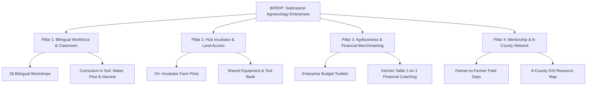

# USDA-NIFA Beginning Farmer and Rancher Development Program (BFRDP)
## Subtropical Agroecology Enterprises: Deliverables & Stakeholder Strategy Checklist

> [!NOTE]
> **Project Title:** Beginning Farmer and Rancher Development Program (BFRDP): Subtropical Agroecology Enterprises  
> **Funding Agency:** USDA National Institute of Food and Agriculture (NIFA)  
> **Grant Period:** 3-Year Project Cycle (2024–2027 / 2026–2029)  
> **Funding Amount:** $748,500  
> **Lead Institution:** University of Texas Rio Grande Valley (UTRGV) / Agroecology & Resilient Agriculture (SARA)  
> **Lead PI / Project Director:** Dr. Alexis Racelis  
> **Target Region:** 8 South Texas Counties (Hidalgo, Cameron, Willacy, Starr, Zapata, Jim Hogg, Brooks, Kenedy)

---

## 👥 Key Contacts & Stakeholder Directory

### 🏛️ Program Leadership & Core Team
| Name / Role | Institution / Affiliation | Core Responsibilities | Contact / Status |
| :--- | :--- | :--- | :--- |
| **Dr. Alexis Racelis** Lead PI & Project Director | UTRGV / SARA | Overall grant execution, PI oversight, regional partner alignment | `alexis.racelis@utrgv.edu` |
| **Dr. Lockman** Narrative & Strategy Lead | UTRGV | Grant narrative drafting, academic reporting, program evaluation | Active narrative writer |
| **Aisha** Grants & Compliance Officer | UTRGV Grants / SARA | Non-narrative compliance, budget reconciliation, documentation checklist | Coordination lead |
| **Alex & Valdez** GIS & Farmer Mapping | UTRGV Geospatial / Agroecology | 8-County spatial mapping, producer intake geodatabase, regional targeting | Active GIS lead |
| **Annalise** Budget & Financial Liaison | UTRGV / Project Admin | Budget capacity monitoring, subcontracts (Kitchen Table Consultants) | Active budget admin |
| **Juan & Demetrio** Field Incubation Leads | Hub of Prosperity | Breaking ground, tractor operations, Tier 1 incubator plot allocation | Field operations |
| **Desiderio / Desi** Field Trials & Sensor Telemetry | UTRGV Agroecology | Cover crop trials, soil moisture/sensor telemetry, microclimate validation | Technical trials lead |

### 🚜 Contractors, Field Instructors & Liaisons
| Name / Role | Organization | Focus Area | Status |
| :--- | :--- | :--- | :--- |
| **Marcelino Garza** Farmer Liaison & Instructor | Good Grow (Formerly PPC Farms) | Farmer outreach, organic production mentoring, practical workshops | Contractor agreement drafted |
| **Patty** Community Outreach Contractor | Regional Partner | Bilingual farmer recruitment, workshop coordination | Contractor agreement drafted |
| **Kitchen Table Consultants** Agribusiness Mentors | External Ag Financial Advisors | Farm enterprise budgeting, business planning, financial benchmarking | Budget review in progress |

### 🌾 Partner Organizations & Letters of Support Network
| Partner Organization | Key Representative | Sector / Role | Collaboration Details |
| :--- | :--- | :--- | :--- |
| **American Farmland Trust (AFT)** | Lindsey Richards, Texas Regional Outreach | Land access, farmland protection, succession | Support Letter Received; Land tenure & transition workshops |
| **South Texas Grazing Land Coalition** | Servando Leal, Chair | Grazing & Livestock | Grazing land stewardship, regenerative silvopasture modules |
| **Hub of Prosperity** | Maria Gonzalez, Farm Manager | Incubator Farm (Edinburg, TX) | Letter on letterhead; 5-acre living lab for beginner plots & tool bank |
| **Sunshine Bounty Farmers** | Matt & Vanessa Ramon | Beginning Organic Farmers | Peer mentoring, specialty crop production & direct marketing |
| **Johnson Partnership** | Travis Johnson (Santa Rosa, TX) | Large-scale / Transitioning | Soil health at scale, strip-tillage, cover crop demonstrations |
| **IDEA Public School Farms** | Jordan Rooney | Youth & Beginning Ag | Educational pipelines, youth-to-farmer pathways |
| **Rio Fresh** | Courtney Schuster (Alamo, TX) | Commercial Veg / Packing | Wholesale readiness, post-harvest handling & cold storage |
| **Hilltop Gardens** | Andy Cruz, Farm Manager (Lyford, TX) | Botanical & Organic Crops | Tropical and medicinal agroecology systems |
| **Crossroads Farm** | George Bennack, Owner/Operator (Lyford, TX) | Diversified Agriculture | Beginner farmer incubator mentor & site host |
| **US Citrus** | Mani Skaria | Citrus & Nursery Ag | Micro-budding, pest resilience, citrus agroforestry |
| **Weaving Webs Farm** | Katie Lavallee | Diversified Agroecology | Direct-to-consumer sales, CSA, ecological weed management |
| **Obst Family Farms** | Stephen Obst | Grain / Row Crops & Livestock | Rotational grazing, cover cropping in dryland environments |
| **TIPA** | Texas International Produce Assoc. | Institutional Markets | Binational trade, market access, food safety regulations |
| **Tamaulipas Ag Partners** | Jaime de Anda / Nelly's Husband (TDA) | Cross-Border & Regional Network | Binational grower knowledge exchange & trade logistics |

---

## 🎯 Core Grant Objectives & Deliverable Pillars

### 📚 Pillar 1: Bilingual Education & Agronomic Training
- [ ] **Curriculum Development:** Complete 12 bilingual curriculum modules tailored for South Texas subtropical pedoclimatic conditions (soil health, water conservation, IPM, heat-tolerant varieties).
- [ ] **Workshop Series:** Deliver 36 hands-on bilingual workshops (12 per year) across Hidalgo, Cameron, Willacy, and Starr counties.
- [ ] **Spanish Interpretation:** Provide simultaneous live interpretation and fully bilingual printed and digital resources for all modules.
- [ ] **Graduation Target:** Graduate at least 60 beginning farmers (minimum 25 classroom + field hours) over the 3-year period.
- [ ] **CEU / UTRGV Certificate:** Issue formal UTRGV Continuing Education Certificates in Subtropical Agroecology Enterprises.

### 🚜 Pillar 2: Hub of Prosperity Incubator & Equipment Access
- [ ] **Incubator Plot Allocations:** Provide dedicated land, drip irrigation, and soil amendments for at least 15 Tier 1 (0–1 yr) beginning farmers at the Hub of Prosperity.
- [ ] **Shared Equipment Bank:** Establish a shared-use equipment depot (two-wheel tractors, seeders, flail mowers, solar dehydrators, harvest crates).
- [ ] **Water & Soil Testing Support:** Offer complimentary water quality testing and comprehensive soil health testing (NPK, Organic Matter, Active Carbon) for incubator plots.
- [ ] **Post-Harvest Facility Access:** Provide washing, grading, and cold storage access to incubator producers before market days.

### 💼 Pillar 3: Agribusiness, Marketing & Financial Benchmarking
- [ ] **Enterprise Budgeting:** Deploy custom crop enterprise budgets for regional high-demand crops (organic greens, roselle, winter squashes, specialty melons).
- [ ] **Financial Coaching (Kitchen Table):** Facilitate 1-on-1 business planning and financial viability benchmarks for at least 30 Tier 2 (1–3 yr) producers.
- [ ] **Market Access Pathways:** Connect cohort participants to at least 3 market channels:
  - Sentli Farmers Market & Hub of Prosperity Markets
  - Local CSA & Food Box Subscriptions
  - Wholesale & Institutional Buyers (via TIPA & regional school districts)
- [ ] **USDA Agency Navigation:** Conduct dedicated navigation clinics on FSA Microloans, NRCS EQIP cost-share programs, and RMA crop insurance.

### 🤝 Pillar 4: Mentorship, Field Days & Regional 8-County Network
- [ ] **Farmer-to-Farmer Mentorship Pairings:** Match 20 beginning producers with established mentor farmers (e.g., Crossroads Farm, Sunshine Bounty, Good Grow).
- [ ] **Regional Field Days:** Host 6 regional on-farm field days demonstrating live silvopasture, cover crop termination, and drip irrigation optimization.
- [ ] **8-County Geospatial Portal:** Launch the interactive GIS Farmer Network Map covering all 8 targeted counties to facilitate land matching and equipment pooling.
- [ ] **Annual South Texas BFR Forum:** Host an annual gathering of beginning farmers and agricultural service providers at the RGV Food Summit.

---

## 📊 Federal Reporting & Performance Metrics (USDA NIFA REEport)
- [ ] **Semi-Annual Progress Reports:** Submit narrative and numerical milestone achievements every 6 months.
- [ ] **Annual Performance Report (REEport):** Compile participant demographic profiles (socially disadvantaged, veteran, women producers), farm acres impacted, and business plan completions.
- [ ] **Final Project Comprehensive Evaluation:** Comprehensive report detailing economic return, acre transitions to regenerative practices, and enterprise survival rate at Month 36.

---

## 🏗️ Leveraged Facilities, Capital Equipment & Living Lab Assets
*Total Base Capital & Infrastructure Leverage: **\$287,837** (Excluding \$500,000 Land Valuation)*

| Asset / Facility Category | Specific Capabilities & Infrastructure | Operational Value / Investment |
| :--- | :--- | :--- |
| **Hub of Prosperity Living Lab** (3707 W. University Dr., Edinburg) | 2.5-acre agricultural living lab, 8 incubator plots (60x70 ft with 100-ft rows), 20 community plots, agrotourism trail | \$500,000 Land In-Kind + \$234,695 Annual Ops |
| **Integrated Post-Harvest Facility** | 40' storage container with dual-AC CoolBot cold storage, 2,500-gal rainwater harvesting shade roof, 20' supply container | \$14,000 Facility Value |
| **BFR Shared Tool & Supply Library** | Comprehensive hand & power tools outfitting 10+ producers, Jang seeder, flame weeder, wood chipper | \$6,500 Tool Library |
| **Tractors & Implements** | John Deere 3038E Compact Tractor (\$29.6k), JD 455 Drill (\$28.5k), BCS walk-behind tractor system with full attachment suite (\$9.5k) | \$74,435 Machinery Fleet |
| **Fleet Vehicles** | 2024 Ford F250 Super Duty (\$58.6k), 2013-2014 Ford F-150 work truck (\$14.5k) | \$73,142 Transport Fleet |
| **Mobile Agroecology Learning Lab (MALL)** | 24-foot covered dual-axle trailer, custom wrap, onboard generator, full wiring, food-truck service window & mobile classroom | \$37,000 Mobile Unit |
| **Shade House & Drip Stockpile** | Enclosed shadehouse with seed production benches, dedicated stockpile of drip irrigation kits for beginner farms | \$14,500 Growing Infrastructure |
| **Soil & Analytical Labs** (UTRGV Science Bldg E-SCNE) | Rooms 1.364, 1.408, 2.478 with dual Carbon/Nitrogen analyzers & ultrasonic environmental controls | \$50,160 Diagnostic Instruments |
| **Ecological & Livestock Assets** | Rolling mobile chicken coop & rotational paddock system, Master Beekeeper managed Honey Bee Apiary | \$4,300 Ecological Systems |

